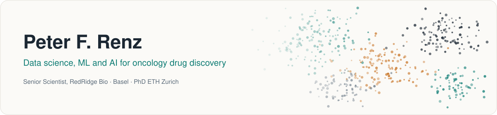
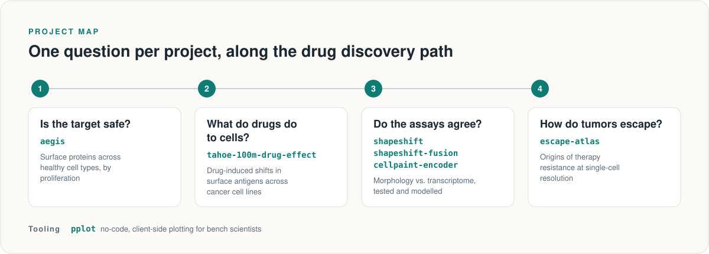

**Computational oncology scientist. I build data science and ML and AI workflows for cancer drug discovery.**

Senior Scientist at RedRidge Bio in Basel, working on antibody-drug conjugates: target selection, payload strategy and the analysis pipelines behind both. PhD from ETH Zurich; first author of a 2024 *Nature* paper on in-vivo CRISPR screens in tumor evolution.

I pre-register analyses where I can and publish the result either way.

### Selected work

| Project | What it shows |
|---|---|
| [**ShapeShift**](https://github.com/Sam-Wo/shapeshift) | Do Cell Painting morphology and Tahoe-100M transcriptomics rank compounds alike? Barely (r ≈ 0.02–0.05), and I traced part of the apparent agreement to a shared-control plate confound in Tahoe. Pre-registered, three datasets, CI. |
| [**shapeshift-fusion**](https://github.com/Sam-Wo/shapeshift-fusion) | Tests whether the two modalities jointly predict drug sensitivity (PRISM). A pre-registered null with bootstrap bounds on the gain it rules out, and a design committed before any model was fit. |
| [**ESCAPE atlas**](https://github.com/Sam-Wo/escape-atlas) | Single-cell atlas of therapy resistance split by origin: pre-existing selection vs. induced plasticity. Lineage-barcoded data show clonal identity predicts survival, and different drug classes select the same survivors. |
| [**Aegis**](https://github.com/Sam-Wo/aegis) | Target safety atlas for ADCs. Plots any surface protein across healthy-tissue cell types against proliferation, so targets on dividing cells in dose-limiting organs stand out. |
| [**Tahoe-100M drug effect**](https://github.com/Sam-Wo/tahoe-100m-drug-effect) | Mines the Tahoe-100M perturbation atlas for drugs that shift surface-antigen expression, cross-referenced with drug sensitivity and normal-tissue safety. |
| [**pplot**](https://github.com/Sam-Wo/pplot) | No-code plotting for bench scientists, fully client-side: dose-response fitting, Kaplan-Meier, volcano, PCA and slide-ready export. TypeScript. |

**In progress:** [cellpaint-encoder](https://github.com/Sam-Wo/cellpaint-encoder), a self-supervised ViT (DINO) for 5-channel Cell Painting images with a hand-written PyTorch training loop.

### Tools

**ML and statistics:** PyTorch, XGBoost, LightGBM, SHAP, scikit-learn, permutation and bootstrap inference
**Biology data:** single-cell RNA-seq, CRISPR screens, Cell Painting, DepMap, PRISM
**Engineering:** Python, TypeScript, Next.js, FastAPI, Docker, CI

### Side projects

[Calm Feed](https://github.com/Sam-Wo/calm-feed) (ragebait filter for social feeds), [Bookster](https://github.com/Sam-Wo/bookster) (LLM summaries and narration of public-domain books), [Anchor](https://github.com/Sam-Wo/blocker-extension) (commitment-based site blocker).
